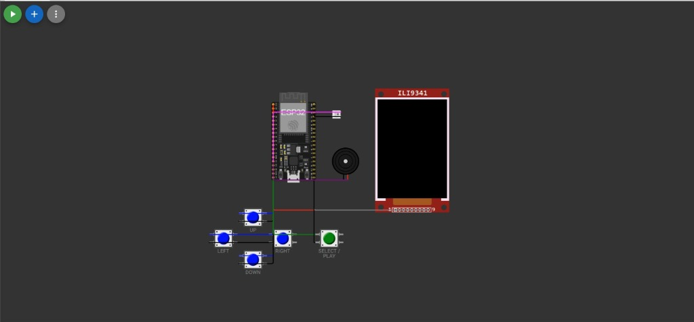
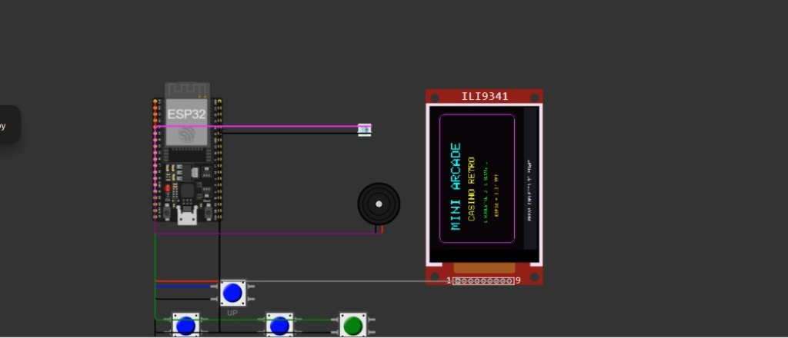
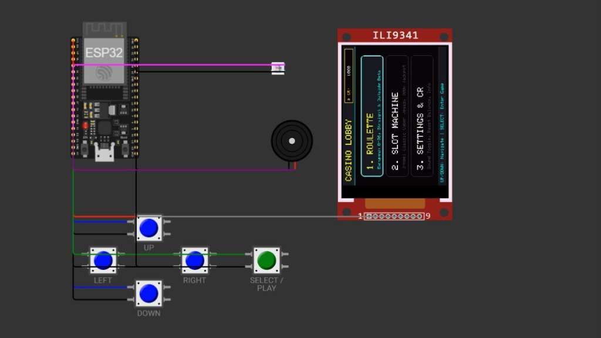
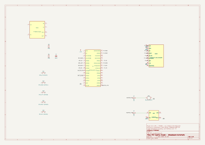

# Mini Casino Arcade (ESP32 + 3.2" TFT)

A do-it-yourself handheld retro casino game console built around an ESP32 DevKit and a 3.2 inch or 3.3 inch ILI9341 SPI color screen.

The console runs two casino games with shared virtual credits, sound effects and RGB lighting feedback:
- **European Roulette (0–36)**: 37-pocket wheel layout, single-number and outside bets (Red/Black, Odd/Even, High/Low), ball physics animation with deceleration and standard casino odds.
- **Cyber 777 Slots**: 3-reel slot machine with weighted RNG, staged reel stops for suspense, winning payline detection and celebratory win animations.
- **Credits**: Shared persistent bankroll across games, sound toggle and credit reset.

Designed to be built on a breadboard or perfboard using through-hole parts and jumper wires.

---

## Photos

### Circuit Layout & Controls

*ESP32 DevKit wired with the 3.2" ILI9341 TFT display, 5 tactile buttons, buzzer, and WS2812B NeoPixel.*

### Boot Splash Screen

*Retro neon animated startup splash screen on the ILI9341 color display.*

### Casino Lobby Menu

*Interactive main menu card selector with shared virtual bankroll counter.*

---

## Game Modes & Screens

The screen features three main modes:
- **Main Lobby**: Navigation menu to select games, view credits, and configure settings.
- **European Roulette**: European 0–36 roulette wheel with straight and outside betting, animated ball physics, and standard odds.
- **Cyber 777 Slots**: 3-reel slot machine with animated spinning reels, staged suspense stops, and jackpot paytable.

---

## Schematic & Wiring

The full electrical schematic is created in KiCad. Included in this repository:
- KiCad Schematic source: [`mini_arcade.kicad_sch`](mini_arcade.kicad_sch)
- Printable PDF schematic: [`mini_arcade_schematic.pdf`](mini_arcade_schematic.pdf)

### Circuit Schematic Diagram

*Complete KiCad circuit schematic showing ESP32 pinouts, SPI TFT connections, button inputs, buzzer, and power lines.*

---

## Firmware Setup (Arduino IDE)

The main Arduino firmware file is [`mini_arcade.ino`](mini_arcade.ino) (or [`sketch.ino`](sketch.ino)).

1. Install Arduino IDE (version 2.x recommended).
2. Add ESP32 board support via **Preferences -> Additional Boards Manager URLs**:
   ```
   https://raw.githubusercontent.com/espressif/arduino-esp32/gh-pages/package_esp32_index.json
   ```
3. Open Library Manager (`Ctrl+Shift+I`) and install:
   - `Adafruit GFX Library`
   - `Adafruit ILI9341`
   - `Adafruit NeoPixel`
4. Connect your ESP32 via USB. Select **ESP32 Dev Module** under **Tools -> Board**.
5. Select the matching COM port. Click **Upload**.
